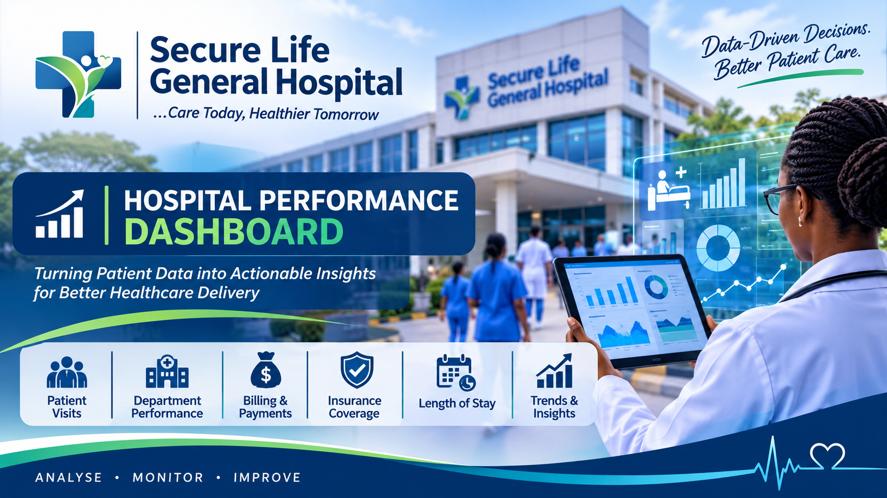

# SECURE LIFE GENERAL HOSPITAL PERFORMANCE DASHBOARD

## INTRODUCTION

This project analyses patient admission, billing and insurance records for Secure Life General Hospital to provide management with a consolidated view of service demand and selected financial indicators. The analysis converts visit-level records into performance measures and visual summaries that can support operational planning, payment monitoring and evidence-informed decisions. The accompanying dashboard allows users to filter results by admission year, department and payment status.

## ABOUT THE DATASET
The source workbook contains 1,000 records, with each row representing one patient visit rather than one unique individual. The main fields include patient ID and name, age, gender, admission and discharge dates, department, diagnosis, total bill amount, payment status, insurance coverage, calculated payment-related fields, length of stay and age category. The records cover admissions from 01 January 2024 to 28 December 2025.
The analysis uses visit count as the measure of patient activity. Monetary values are presented in GHS for dashboard readability; the dataset does not explicitly identify a currency field, so the currency should be confirmed before formal financial reporting. Patient names and IDs are excluded from the dashboard visuals to minimise unnecessary exposure of personal information.

## PROBLEM STATEMENT
Hospital management has observed changes in patient admissions, outstanding medical bills and insurance coverage across departments but does not have a single consolidated report that clearly explains operational and financial performance. Without an integrated view of visit volumes, department demand, length of stay, billing patterns and payment status, management may find it difficult to identify pressure points, monitor revenue collection and prioritise improvement actions. This project addresses the reporting gap by analysing the supplied patient-visit dataset and presenting key indicators in an interactive dashboard.

## DASHBOARD VISUALIZATION
The figure below is a static preview of the dashboard. The separate HTML dashboard is interactive: use the year, department and payment-status filters to update the KPI cards and charts.

!

Interactive dashboard file: Secure_Life_Interactive_Dashboard.html (open in a modern web browser).

## KEY INSIGHT
•	The dataset contains 1,000 patient visits across six departments, with 1,000 distinct patient IDs in the supplied records. The visit count should not be described as unique patients in general because repeat visits are possible.
•	General recorded the highest visit volume (252 visits; 25.2% of all visits). Neurology recorded the lowest (94).
•	Orthopedics generated the highest total bill amount (GHS 2,553,862.32), despite not having the highest visit volume. This indicates a materially higher average bill per visit in this department.
•	The average length of stay across all visits was 4.81 days. Orthopedics had the longest average stay (8.38 days), while Emergency had the shortest (2.03 days).
•	Payment status was: Paid 564 (56.4%); Pending 257 (25.7%); and Partially Paid 179 (17.9%).
•	Total bills amounted to GHS 8,053,143.44. Bills attached to records classified as Paid total GHS 4,568,527.32. The remaining GHS 3,484,616.12 is an estimated unpaid/part-paid exposure derived from status classification, not a verified cash-receivable balance.
•	Average recorded insurance coverage was 74.9%. Coverage averages varied relatively modestly by department, from 73.9% (General) to 76.3% (Cardiology). Diagnosis-level averages also vary; interpretation should consider the number of visits in each diagnosis group.
•	The largest age category was Btwn 51&65 (235 visits; 23.5%), followed closely by 66& Above (232).
•	Admissions peaked in November 2025 with 57 visits. The highest monthly billed amount occurred in November 2025 (GHS 510,413.50). Monthly patterns should be reviewed alongside capacity and case mix.
•	The gender distribution was relatively balanced: Female 51.2% and Male 48.8%. Average patient age was 46.1 years.

## ADDITIONAL MANAGEMENT OBSERVATIONS AND DATA QUALITY
Orthopedics and Cardiology contribute a large share of the hospital’s billed value, while General records the highest number of visits. Management should therefore assess both workload and financial value rather than using visit count alone to allocate resources.
A payment-data reconciliation is required before the dashboard’s outstanding estimate is used for accounting decisions. In the supplied workbook, the “Amt Paid Only” field records the full bill for Paid-status rows and zero for Pending/Partially Paid rows, so it behaves as a status-based classification rather than a confirmed cash receipt. The “Actual Amount Paid” field also does not reconcile to the Paid-status bill total. Confirm the definitions and reconcile both fields against the billing ledger and receipts.
The dataset has no explicit currency label, payer/insurer identity, invoice due date, payment transaction date, readmission flag or bed-capacity measure. Consequently, the analysis cannot reliably calculate collection time, insurer-specific performance, readmission rates, bed occupancy or unique-patient outcomes. Diagnosis-level insurance comparisons should be interpreted with care where group sizes are small.

## RECOMMENDATIONS
1.	Prioritise billing and cost review in Orthopedics and Cardiology, which account for the largest billed amounts. Review major cost drivers, procedure mix and billing accuracy.
2.	Establish a daily or weekly accounts-receivable report that separates gross charges, insurer-approved amounts, patient responsibility, actual cash received, adjustments and outstanding balances by invoice age.
3.	Create a follow-up workflow for Pending and Partially Paid accounts, with clear ownership, due dates and escalation thresholds. Track recovery rates over time rather than relying only on payment-status labels.
4.	Review staffing, bed utilisation and discharge processes in departments with longer average stays, particularly Orthopedics and Neurology. Interpret length of stay in light of diagnosis severity and clinical appropriateness.
5.	Use monthly admission and billing trends in capacity, staffing, inventory and budget planning. Investigate unusual peaks or declines before making resource changes.
6.	Validate insurance coverage and eligibility at registration and before discharge; monitor coverage exceptions by department and diagnosis to reduce avoidable billing disputes.
7.	Improve data governance by defining each payment field, standardising currency and date formats, applying validation rules, and maintaining a data dictionary. Use a privacy-conscious dashboard that does not display patient names or identifiers.
8.	Extend the dashboard with invoice ageing, actual collection rate, insurer-level performance, readmissions and bed occupancy when reliable fields become available.

 ## CONCLUSION
The analysis provides Secure Life General Hospital with a consolidated overview of 1,000 patient visits across six departments over the 2024–2025 admission period. It identifies differences between service demand and billed value, highlights variation in length of stay, summarises payment-status exposure and shows how admissions and billing change over time. The interactive dashboard supports further exploration through filters. The most important next step is to strengthen payment-field definitions and reconcile the dataset with the hospital’s financial records so that management can confidently use outstanding-balance and collection measures in operational decisions.
## PROJECT FILES
•	Hospital_Patients_Dataset (1).xlsx – source data workbook
•	Secure_Life_Interactive_Dashboard.html – interactive dashboard
•	Dashboard_Preview.png – static dashboard image used in this report
•	Introductory_Image.png – project introductory banner

